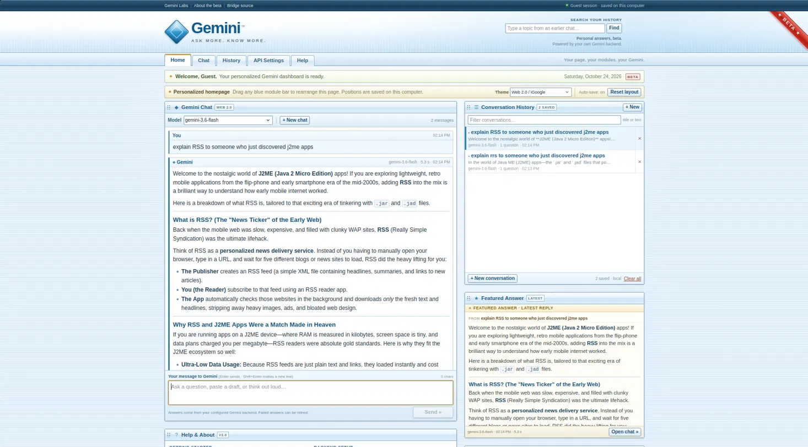
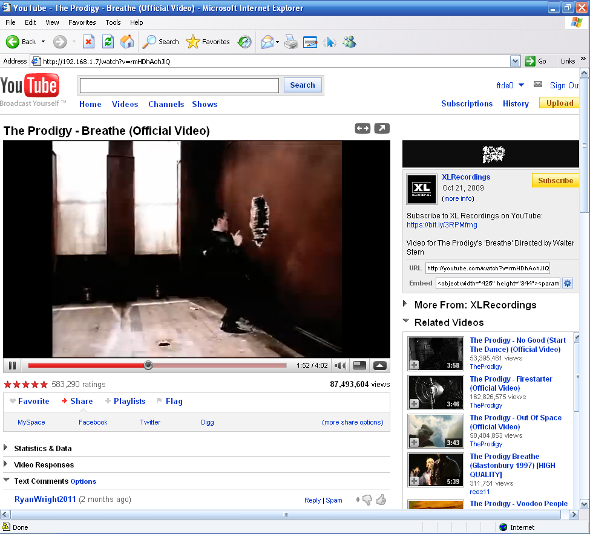

# Retro setup

A full retro-computing salon: a themed Windows experience plus retro-feeling web apps for Gemini/Google, Spotify, YouTube, Reddit, and more.

This page is the top-level walkthrough. Each subfolder keeps its own quick-start notes in `START.md`.

## Quick retro suit start

If you just want the whole thing in one look, here is the shortest path once the basics are in place.

| What            | Command / action                                                                                                              | Result                                    |
| --------------- | ----------------------------------------------------------------------------------------------------------------------------- | ----------------------------------------- |
| Install the ISO | Download and install [Windows Experience Freestyle Update SP1](https://archive.org/details/windows-experience-freestyle-sp1/) | Retro Windows base                        |
| Install Node    | From the browser in that Windows setup, grab Node from [nodejs.org](https://nodejs.org/en/download/current)                   | `node` and `npm` available                |
| Extract the zip | Unzip `windows.zip` on the machine                                                                                            | `windows/` folder with all the projects   |
| Install deps    | `windows\setup.cmd`                                                                                                           | Project dependencies installed            |
| Gemini Retro    | `windows\ai_apps\start.cmd`                                                                                                   | Gemini app + optional bridge              |
| Retro PKP       | `windows\start-retro-pkp.cmd`                                                                                                 | Local PKP timetable app                   |
| Spotamp         | `windows\build-spotamp.cmd`, then load `windows\spotamp\dist` unpacked                                                        | Winamp-style Spotify extension            |
| yt2009          | `windows\start-yt2009.cmd`                                                                                                    | Retro YouTube server                      |
| Reddit          | Tampermonkey: paste `windows\redirect-old-reddit.js`                                                                          | Modern Reddit redirects to old.reddit.com |

Keep any running window open; press `Ctrl+C` to stop a server.

Details are below, and the Windows-side launch notes are in [`windows/README-WINDOWS.md`](windows/README-WINDOWS.md).

If the eXPerience skin or Spotamp misbehaves, see [`EDGE_CASES.md`](EDGE_CASES.md) for the known issues and the pre-extracted Firefox 115.0esr build.

## What you need

- [Windows Experience Freestyle Update SP1](https://archive.org/details/windows-experience-freestyle-sp1/)
- `windows.zip` from this repo
- Node.js, installed from [nodejs.org](https://nodejs.org/en/download/current)

## Step 1 — install the ISO

It’s not that hard.

1. Download the `Windows Experience Freestyle Update SP1` ISO from the link above.
2. Mount or burn it the way you normally would.
3. Install it on your machine (or VM) and let it finish.

If you want a clean retro image, a VM is the easiest place to try it without touching your real setup.

## Step 2 — install Node from the “Internet Explorer”

It’s Firefox under the hood, but yknow. Or maybe you don’t. Anyways…

1. Open the browser that comes with the Windows setup.
2. Go to [nodejs.org/en/download/current](https://nodejs.org/en/download/current).
3. Grab the version for your system and install it.
4. Open a command prompt and make sure it works:

```cmd
node --version
npm --version
```

## Step 3 — extract the zip

1. Copy `windows.zip` onto the Windows machine.
2. Extract it somewhere easy to find, like the Desktop or `C:\retro`.
3. You should end up with a `windows` folder containing the subfolders for each project.

## Step 4 — run `setup.cmd`

1. Open Command Prompt in the extracted `windows` folder.
2. Run:

```cmd
setup.cmd
```

That installs the dependencies for the projects that need them. It does **not** copy credentials, cookies, keys, or runtime data from another machine.

## Starting stuff

For the real launch commands and per-project notes, see [`windows/README-WINDOWS.md`](windows/README-WINDOWS.md).

In short:

- **Gemini Retro** — `ai_apps\start.cmd`
- **Retro PKP** — `start-retro-pkp.cmd`
- **Spotamp** — `build-spotamp.cmd`, then load `spotamp\dist` as an unpacked extension
- **yt2009** — `start-yt2009.cmd` (finish its upstream setup first if required)

Keep the window open while a server is running; press `Ctrl+C` to stop it.

## The projects

### Gemini

A Gemini chat thing with two backends: the Gemini API and a local `web2api` bridge. It was made by me and Freebuff (AI).

Themes are inspired by:

- iGoogle
- MSN Messenger
- Gadu Gadu
- Windows 98/XP desktop assistants (mainly Clippy)



The project lives in `ai_apps/`. Both `gemini-web2api` and the retro web app are there.

- `gemini-web2api` — local bridge that translates the app into Gemini requests.
- The retro app itself — three skins: Web 2.0 dashboard, messenger window, and a Windows 98/XP assistant style.

Quick start:

1. Copy `.env.example` to `.env` if you want API mode with a key.
2. Run `ai_apps\start.cmd` from the `windows` folder.
3. Open the printed local URL.

If you want to send the Gemini app window to a PNG for the tutorial, use your browser’s screenshot workflow from the Retro PKP section below.

### Spotamp

Spotify, but Winamp.

It is a browser extension that hides Spotify’s normal interface and runs a Winamp-style desktop instead. Spotify still does the real work: catalog, playlists, playback, account, everything. Spotamp just restyles and rewires the visible player.

Spotamp is an independent fan project and is not affiliated with Spotify or Nullsoft/Winamp.

Build and load it:

```cmd
cd windows
build-spotamp.cmd
```

If you want a second look, there is also `screenshots/spotamp-popup.png` in the repo.

Then:

1. Open `chrome://extensions` (or `edge://extensions`).
2. Turn on **Developer mode**.
3. Choose **Load unpacked** and select `spotamp\dist`.
4. Open <https://open.spotify.com/>.

Full start notes are in [`windows/spotamp/START.md`](windows/spotamp/START.md).

### YouTube 2009

Two retro Google/YouTube routes, side by side. Pick whichever fits the vibe you want.

#### yt2009 — full retro YouTube frontend

A fairly accurate 2009 YouTube frontend. This is already an existing project by ftde0.



Source/project: [ftde0/yt2009](https://github.com/ftde0/yt2009/)

This repo includes a copy in `yt2009/`. The Windows side is in `windows/yt2009/`.

Good fit when you want the real YouTube-service feel of that era rather than just the Google portal look.


Pros:

- It is a full YouTube frontend, not just a skin
- Account stuff, old-player toggles, and the 2009 browse/comment/gdata-era flow are all in there
- There is already a lot of documentation around setup and the flash-player path

Cons:

- It is a real server project, so the setup is heavier than a skin
- Some of the YouTube-side wiring can break over time and usually needs updates
- There are more prerequisites, and it can take up space over time as assets get cached

There is another yt2009 screenshot in `screenshots/yt2009-2.png` if you want to see the IE6-style view too.

#### GPlEx Extended — classic Google portal look

If what you want is the old Google/Youtube/Google Maps vibe, GPlEx Extended is the other route.

- [gplexextended.com/download](https://gplexextended.com/download)GPlEx Extended is the right pick when the goal is the classic Google portal feel rather than a retro YouTube backend. 


Good fit when the goal is the classic Google portal experience rather than a YouTube-only retro frontend.

Pros:

- Great if the goal is the old Google apps look and feel
- Usually easier if you just want Google search, Gmail, Maps, and Youtube in that era style
- Less of a self-hosted server project than yt2009

Cons:

- It targets the classic Google portal feel, so it is not the same thing as a retro YouTube backend
- Which one wins depends on whether you care more about Google’s portal vibe or YouTube’s 2009 UI
- It is a different project with its own setup and update path

### Reddit

Old Reddit already exists, so there’s no point reinventing it.

Use this simple Tampermonkey redirect instead:

1. Install Tampermonkey if you don’t already have it.
2. Create a new script in Tampermonkey.
3. Paste in `windows/redirect-old-reddit.js`.
4. Save it.

That’s it — it sends you to `old.reddit.com`.

If you want to keep the script somewhere easy to drop into a fresh browser, the file is
at [`windows/redirect-old-reddit.js`](windows/redirect-old-reddit.js).

### Screenshots for this guide

If you want to update any of the screenshots in this repo, use whatever browser you have open:

- DevTools: `Ctrl+Shift+P` / `Cmd+Shift+P`, then `Capture full size screenshot`.
- For a selected part: `Capture area screenshot`.
- For the visible viewport only: `Capture screenshot` if your Chromium has it.

Save the PNG into `screenshots/` and update the link in RETRO_SETUP.md if the filename changes.

For Retro PKP, if you want the tutorial screenshot to show the actual retro page, screenshot the Retro PKP window after you open `http://127.0.0.1:8000`. The page already has the retro PKP styling built in, so no extra CSS is needed before the shot.

```js
// ==UserScript==
// @name         Reddit -> old.reddit.com
// @namespace    http://tampermonkey.net/
// @version      1.0
// @description  Redirect modern Reddit to old.reddit.com
// @match        *://www.reddit.com/*
// @match        *://reddit.com/*
// @grant        none
// @run-at       document-start
// ==/UserScript==

(function () {
  'use strict';

  var domain = 'old.reddit.com';
  var current = window.location.hostname;

  if (current === domain || current.endsWith('.' + domain)) {
    return;
  }

  var target = window.location.href
    .replace(/^https?:\/\/(www\.)?reddit\.com/, 'https://' + domain)
    .replace(/\/$/, '') + '/';

  window.location.replace(target);
})();
```

## Maybe later

Possible add-ons, if someone wants them:

- Telegram
- Facebook Messenger
- WhatsApp

## Quick start of everything

Each subfolder has a `START.md` with its own short launch guide:

- [`windows/ai_apps/START.md`](windows/ai_apps/START.md)
- [`windows/spotamp/START.md`](windows/spotamp/START.md)
- [`windows/yt2009/START.md`](windows/yt2009/START.md)
- [`windows/retro-pkp/START.md`](windows/retro-pkp/START.md)

## CREDITS

- Windows Experience Freestyle Update SP1 — **Hayafumi** ([archive.org/details/@hayafumi](https://archive.org/details/@hayafumi))
- Gemini web2api — **Sophomores** ([github.com/Sophomoresty](https://github.com/Sophomoresty))
- Spotamp assets and code from **Webamp** ([github.com/captbaritone/webamp](https://github.com/captbaritone/webamp)), by **Jordan Eldredge** ([github.com/captbaritone](https://github.com/captbaritone))
- GPlEx — **Ziptino9098** ([github.com/Ziptino9098](https://github.com/Ziptino9098))
- yt2009 — **ftde0** ([github.com/ftde0/](https://github.com/ftde0/))

## CONTRIBUTIONS

If you know a retro clone or modification for any other site or app, feel free to send a pull request using this template.

PR template: [`.github/PULL_REQUEST_TEMPLATE/retro-addition.md`](.github/PULL_REQUEST_TEMPLATE/retro-addition.md)

### What a retro addition should include

- One clear project, not a vague collection of stuff
- Where the code/assets come from
- What the retro angle is
- Whether it is standalone, an extension, a local server, or a browser script
- Any install steps a new user actually needs
- Screenshots if there are any worth showing
- Credits for the upstream project or assets
- A short “what works / what doesn’t” note if it has honest limitations

If you’re adding something large, keep its own `START.md` and screenshots folder so this top-level file stays readable.
