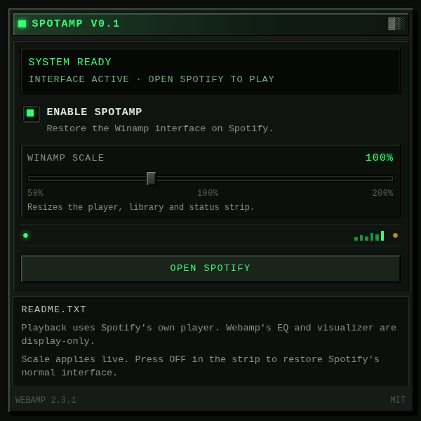

# Spotamp

Spotamp is a Manifest V3 browser extension that turns the Spotify Web Player
into a late-1990s Winamp 2–style desktop. Spotify remains the real application:
its catalog, playlists, albums, artists, search, account and audio playback are
untouched. Spotamp hides Spotify's visible client chrome entirely and embeds
[Webamp](https://github.com/captbaritone/webamp) as the only player, wired to
Spotify's own playback controls. A matching Winamp-style library window is the
only way to browse routes, folders and playlists.

**Quick start:** [START.md](START.md) walks through building, loading the
unpacked extension, and the first-run controls.

## Preview

The toolbar popup is rendered at 1.5× and carries the enable switch and the
50–200% scale slider:



## What works

| Area | Behaviour |
| --- | --- |
| Desktop shell | Spotify's top bar, sidebar, content pane and now-playing bar are hidden. Webamp's main, equalizer and playlist windows plus the Spotamp library are the entire visible interface. |
| Library window | A `C:\SPOTAMP` folder tree (`home\`, `search\`, `liked-songs\`, `playlists\`), real saved playlists as `M3U` rows, a `FIND` box, and links to the albums/artists/tracks on the current page. |
| Home | Spotify Home still loads underneath and supplies the real shortcuts and recommendation tracks to Webamp's playlist. The page itself is not painted. |
| Search | The `FIND` box opens Spotify's real search route; results populate the library's folder contents and Webamp playlist. |
| Playlists | Playlist, Daily Mix and Liked Songs rows populate Webamp's playlist editor; the real page remains the source of metadata and playback. |
| Albums and Artists | Their tracks and links remain browsable through the library window; the Spotify page is hidden. |
| Shared player | Webamp is the only player. Spotify's duplicate transport bar is never shown. |
| Webamp | Main window, playlist editor, equalizer, time display, seek bar, volume, three-state shuffle (OFF / ON / SMART), repeat, skins and draggable windows. A 50–200% UI scale (popup slider; `2X` or Ctrl+D for 100%/200%) scales every Winamp window and the status strip with nearest-neighbour pixels. |
| Navigation | Folders click through to an equivalent Spotify anchor when one exists, so SPA route changes are detected without a reload and without duplicating Webamp. |
| Reversible | Popup toggle and the `OFF` button restore Spotify's normal interface. |

### Playback integration

Webamp's visible controls are connected to Spotify's existing DOM controls by a
small adapter (`src/content/playback/`). No Spotify Web API key is required.

Synchronized both ways where Spotify's DOM exposes the state:

- Play / pause
- Previous / next track
- Playback progress and seeking
- Volume
- Shuffle and repeat. The shuffle control cycles Spotify's three modes:
  **OFF → ON → SMART → OFF**; the current mode is shown in the status strip
  (`SHUF OFF`, `SHUF ON`, `SHUF SMART`) and in the Webamp shuffle tooltip.
- Track title, artist, album and artwork
- Playback-state changes initiated inside Spotify, including track changes
- Playing a row from the Webamp playlist by clicking Spotify's row play button

Commands that Spotify rejects or ignores are reported in the Spotamp status
strip; Spotamp never fakes a successful play. Playback still depends on
Spotify's own requirements (signed-in account, an active device, and whatever
the current web player allows in the user's region/plan).

### Honest limitations

- **No audio is captured.** Spotify audio is not routed through Webamp. Webamp's
  equalizer, balance, preamp and visualizer are display-only; they do not alter
  Spotify's stream. The analyser deliberately reports silence.
- **DOM integration, not an official API.** Spotamp reads and clicks Spotify's
  accessible controls. If Spotify ships a redesign that removes the selectors
  in `src/content/selectors.ts`, the affected feature degrades to the base
  theme with a visible notice instead of breaking the page.
- **No local files or arbitrary URLs.** Webamp's file/URL loading cannot play
  through Spotify, so Spotamp refuses those URLs rather than pretending.
- **Spotify's page content is intentionally invisible.** Spotamp reads the live
  DOM for tracks and links, but the Winamp desktop is the only painted UI. This
  is a deliberate single-interface design; there is no toggle to show Spotify's
  content pane inside Spotamp mode (use `OFF` to restore the original page).
- **Webamp global hotkeys and Media Session are disabled.** They would compete
  with Spotify's own keyboard and system media shortcuts. Webamp's window,
  playlist, seek, volume and skin interactions remain active.
- **Seeking and volume are best-effort.** They set Spotify's native range
  inputs and dispatch `input`/`change` events; Spotify must accept the command
  for the change to take effect.
- **Smart Shuffle depends on Spotify.** If Spotify's shuffle button is disabled
  for the current account, plan or playback context, Spotamp refuses the click
  and reports it instead of showing a mode change that did not happen.
- Full Spotify playback was **not** exercised against a signed-in account in
  this environment. See [Verification](#verification).

## Install

Requirements: Node.js 20+ and a Chromium-based browser (Chrome/Edge 114+).
For the shortest path, see [START.md](START.md).

```bash
npm ci
npm run build
```

Then:

1. Open `chrome://extensions` (or `edge://extensions`).
2. Enable **Developer mode**.
3. Choose **Load unpacked** and select the generated `dist/` directory.
4. Open <https://open.spotify.com/>. Spotamp is enabled by default.

No parameters, hosting, Spotify developer app or API key are needed. The
extension requests only `storage` (for the on/off and scale settings) and
access to `https://open.spotify.com/*`. If the interface does not appear after
installation or an update, refresh the Spotify tab once so Chrome injects the
new content script.

To disable, use the toolbar popup toggle or the `OFF` button in the Spotamp
status strip. The page returns to Spotify's normal appearance immediately; a
reload is only needed if Spotify itself is in a bad state.

### Updating the build

`npm run dev` rebuilds the content script on change (reload the extension and
the Spotify tab after changes). `npm run build` produces the complete, clean
`dist/` directory.

### Shipping a release

`npm run package` builds the extension and writes a Chrome Web Store-ready
archive to `release/spotamp-<version>.zip`. The archive contains the contents of
`dist/` at its root (not a nested `dist/` folder), including `manifest.json`,
`content.js`, the popup, icons, and the Webamp licence/notices.

1. Bump the version in **both** `package.json` and `public/manifest.json`.
   `npm run build` fails with a clear error if they differ.
2. Run `npm ci` on a clean checkout.
3. Run `npm run typecheck`, `npm run lint`, and `npm test`.
4. Run `npm run package` and upload `release/spotamp-<version>.zip`.
5. Capture your own store-listing screenshots against a Spotify account you do
   not mind showing. The Chrome Web Store requires a 1280×800 image; do not
   commit personal playlists, names, or avatars.

Store-listing notes:

- **Single purpose:** restyle the Spotify Web Player as a Winamp-style player
  and connect Webamp's controls to Spotify's existing playback controls.
- **Permissions:** `storage` stores the enabled flag and UI scale; the
  `https://open.spotify.com/*` match/host permission is required to inject the
  content script. There are no other permissions.
- **Remote code:** none. Webamp and all CSS/skin assets are bundled into
  `content.js`; the extension makes no script, font, or asset requests to
  third-party servers.
- **Privacy:** no analytics, telemetry, accounts, audio capture, or data
  transmission. See [Privacy and permissions](#privacy-and-permissions).
- **Third-party licence:** `WEBAMP-LICENSE.txt` and `THIRD_PARTY_NOTICES.md`
  are inside the archive.

`dist/` and `release/` are generated and ignored by Git. The full source lives
in `src/`, `public/`, `scripts/`, and `tests/`; no minified-only delivery is
required to rebuild the extension. `references/webamp/` is an upstream checkout
used only to reproduce the vendored Webamp bundle and is not committed (it is
large and has its own Git repository); the shipped bundle and its licence are
under `src/vendor/webamp/`.

### Privacy and permissions

Spotamp runs only on `https://open.spotify.com/*`. It reads the page's existing
DOM to find track names, links, artwork, and Spotify's own player controls. That
processing happens locally in the tab. The extension does not call a Spotamp
server, does not use analytics or telemetry, does not read Spotify credentials,
and does not download, proxy, capture, or record Spotify audio.

Settings are stored with `chrome.storage.sync`: `spotamp.enabled` (boolean) and
`spotamp.scale` (0.5–2.0). Chrome may sync those values through the user's
signed-in browser profile; Spotamp itself never receives them. Removing the
extension removes its local storage.

## Architecture

```text
src/
├── content/
│   ├── index.ts                 content-script bootstrap
│   ├── app.ts                   lifecycle, enable/disable, shared chrome
│   ├── settings.ts              chrome.storage sync + in-memory fallback
│   ├── navigation.ts            SPA route watcher (MutationObserver + history)
│   ├── pageDetector.ts          URL/DOM → page kind and label
│   ├── selectors.ts             central selector/attribute map
│   ├── tracks.ts                track-row extraction and matching
│   ├── adapters/                home, search, playlist, album, artist,
│   │                            dailyMix, likedSongs, sidebar, folders, player,
│   │                            unknown
│   ├── playback/
│   │   ├── spotifyDom.ts        read state, click controls, set ranges
│   │   └── spotifyPlaybackAdapter.ts  polling, commands, verification
│   ├── webamp/
│   │   ├── loader.ts            loads the vendored UMD bundle
│   │   ├── spotampWebamp.ts     windows, playlist sync, click bridge
│   │   ├── spotifyMedia.ts      Webamp media shim → Spotify commands
│   │   └── webampTypes.ts       minimal typing for Webamp's public API
│   ├── styles/content.css       shell, library layout and page treatments
│   ├── styles/winamp-gen.css    base-2.91 generic-window skin graphics
│   └── vendor/webamp/           Webamp 2.3.1 UMD build + MIT licence
├── types/vendor.d.ts
public/
├── manifest.json                MV3 manifest
├── popup.html / .css / .js      retro settings popup
└── icons/
tests/                           Vitest + jsdom suite
scripts/build.mjs                esbuild content bundle + static copy
scripts/package.mjs              version check + Chrome Web Store zip
START.md                         quick start for loading the extension
```

### Lifecycle and cleanup

`SpotampApp` owns everything Spotamp adds. `enable()` starts one
`NavigationWatcher` and mounts the shared chrome once; `disable()` stops the
watcher, destroys Webamp, the status strip, observers and the playback adapter,
removes every `data-spotamp-*` marker, the injected stylesheet and the page
classes. `stop()` also detaches the settings subscription. Re-enabling or
re-injecting the content script replaces the previous instance.

Navigation checks are debounced, and the playback adapter polls every 550 ms
and pauses polling while the tab is hidden, so DOM observation does not run a
full-page scan in a tight loop.

### Winamp desktop shell

`html.spotamp-shell` hides `main`, the sidebar, the now-playing bar and the top
bar with `display: none`, so no part of Spotify's client is painted. The hidden
DOM remains live: page adapters annotate it, `collectPageTracks` feeds Webamp's
playlist, and the playback adapter keeps clicking Spotify's own transport
controls. `#spotamp-library` is a separate draggable window that renders
`C:\SPOTAMP` folders, the current path, saved playlists, and page links. Folder
clicks prefer a real Spotify anchor with the same `href` so routing stays
client-side; saved playlist rows activate Spotify's own library row control.
The popup's **WINAMP SCALE** slider sets any scale from 50% to 200% in 5%
steps. `SpotampApp` writes it to `--spotamp-ui-scale` (and the inverse to
`--spotamp-ui-inv-scale`) on `html`; the Webamp deck, library, status strip and
help dialog all use `transform: scale(...)` with
`image-rendering: pixelated`, so their sprites and small text grow together
without blurring. The library's box width and height are divided by the scale,
which keeps its painted window 20px inside the viewport and 12px above the
status strip at every size; its left edge follows the deck at
`36px + 567px × scale`.

`2X` (or Winamp's Ctrl+D) is a shortcut for the persisted 100%/200% toggle, and
its label flips to `1X` at 200%. The scale is stored in
`chrome.storage.sync` beside the enabled flag (`spotamp.scale`), so it survives
reloads and applies live while Spotify is open. Until a scale is chosen, the
original roomy default applies: 200% when the window is at least 1600×800,
otherwise 100%. At 1600×900 the 200% deck ends
at x=1154 and the library occupies x=1170–1580; at 150% it ends at x=1170 and
the library occupies x=1180–1580. Smaller scales leave the deck compact; the
status strip narrows by the inverse so its painted width always spans the
viewport.

### Library chrome

The library is not hand-drawn. It reproduces Webamp's `GenWindow` structure
(`gen-window`, `gen-top`, `gen-middle`, `gen-bottom`) and uses the generic-window
and bitmap-title graphics embedded in the bundled `base-2.91` skin. Those rules
are extracted into `src/content/styles/winamp-gen.css` from Webamp's
`base-skin.css`, scoped to `#spotamp-library`; the title is rendered from the
same skin glyphs with `gen-text-*` spans. Body lists use the playlist palette
from `PLEDIT.TXT` (`#00FF00` on `#000000`, `#0000C6` selection) and its Arial
9px type. Changing Webamp's skin from its own menu changes the player windows,
but the library keeps the bundled base-2.91 chrome.


### Webamp integration

Webamp is not reimplemented. `src/vendor/webamp/webamp.bundle.min.cjs` is the
official browser UMD build of Webamp 2.3.1 produced from the local checkout in
`references/webamp/` (reproduction steps are in
[`src/vendor/webamp/README.md`](src/vendor/webamp/README.md)). esbuild inlines
the bundle into `dist/content.js`; the extension never executes remote code.

Spotamp instantiates Webamp with a custom media class via the documented
`__customMediaClass` option and arranges the main, equalizer and playlist
windows in `windowLayout`. The shim implements Webamp's media interface and
translates `play`, `pause`, `stop`, `loadFromUrl`, seeking, volume and EQ calls
into Spotify DOM actions or explicit no-ops. Playlist tracks use
`spotamp:track:` / `spotamp:match:` URL keys so no media request is made for
Spotify content. Webamp's own UI, skin, playlist editor, window handling and
keyboard interactions remain intact.

The default skin is embedded in the Webamp bundle, so the content script needs
no `web_accessible_resources`. MIT licence and third-party notices are copied
into `dist/` (`WEBAMP-LICENSE.txt`, `THIRD_PARTY_NOTICES.md`).

### Selector map

All selectors live in [`src/content/selectors.ts`](src/content/selectors.ts).
They were derived from Spotify's live Web Player DOM and prefer stable
`data-testid` values and accessible labels over generated class names. Captured
pages are not kept in this repo, so no personal library data is stored:

- App shell: `[data-testid="root"]`, `[data-testid="global-nav-bar"]`
- Sidebar: `nav[aria-label="Main"]`, `#Desktop_LeftSidebar_Id`
- Player: `[data-testid="now-playing-bar"]`, `now-playing-widget-v2`,
  `control-button-playpause`, `control-button-skip-back/forward`,
  `playback-progressbar` range, `volume-bar` range, repeat/shuffle buttons
- Content: `home-page`, `entity-header`, `entityTitle`, `action-bar`,
  `track-list`, `tracklist-row`, `internal-track-link`, shelves and cards
- Search: `search-input`, `search-dropdown`, tab lists

Every lookup is nullable. Missing controls produce a status-strip notice, not a
thrown exception, and the retro styling still applies.

## Verification

Run locally:

```bash
npm run typecheck   # tsc --noEmit
npm run lint        # eslint .
npm test            # vitest run
npm run build       # production extension in dist/
```

The test suite covers page detection, SPA navigation, selector lookup against
the captured snapshots, page adapters, Webamp media translation, playback
adapter commands/verification/errors, all seven captured page types (Home,
Search, Playlist, Album, Artist, Daily Mix, Liked Songs), the folder tree's
routes/active folder/cleanup, the library window's saved-playlist and SPA-link
behaviour, the authentic generic-window chrome, late Spotify-shell mounting,
UI scale normalization/notifications, double-size toggling/shortcut cleanup,
and full lifecycle cleanup (65 tests in 10 files).

Additional manual browser verification performed for this build, using the
captured Home DOM served locally with the built content script and Webamp
bundle (Spotify's scripts removed):

- Webamp mounted all three windows (main 275×116, playlist 275×232,
  equalizer 275×116) with the default skin.
- The live Spotify shell was fully hidden; the only visible elements were the
  Webamp windows, the Spotamp library window and the status strip.
- The library showed `C:\SPOTAMP\PLAYLISTS \ TEST PLAYLIST`, the four folder
  rows and the saved playlists plus the current page's browse links.
- Home was detected and themed; SPA transitions to Search, Album, Playlist,
  Daily Mix, Liked Songs and Artist updated classes/labels.
- Every route kept exactly one Webamp container, one status strip and one
  stylesheet set.
- At 200%, the main window measured 550×232, the playlist 550×464, the
  equalizer 550×232 and the library 410×828 — all with
  `image-rendering: pixelated`. The status strip measured 1600×40 at 1600×900,
  so it scaled with the windows instead of staying at 1x; at 150% it measured
  1600×30 and at 100% 1600×20. No horizontal overflow was reported.
- The popup renders at 1.5× (`zoom: 1.5`) in a 600×599 viewport: the
  WINAMP SCALE slider, live percentage, enable switch, notes and footer all
  fit without a scrollbar. Moving the slider updates the setting immediately.
- Disabling removed Webamp, markers, stylesheet, `spotamp-double` and theme;
  re-enabling mounted a single fresh instance.
- After the duration fix, the console showed no failed audio probes for
  `spotamp:` playlist URLs.

**Not verified:** a signed-in Spotify session was unavailable, so live
catalog rendering, actual Spotify playback, seek/volume acceptance and
cross-page styling with real data still need manual testing in a normal
browser with the unpacked extension. Treat those as integration checks, not
established results.

## Licences

Webamp is MIT-licensed; its licence is included in the extension. Spotamp is an
independent fan project, not affiliated with Spotify or Nullsoft. See
[`THIRD_PARTY_NOTICES.md`](THIRD_PARTY_NOTICES.md).
