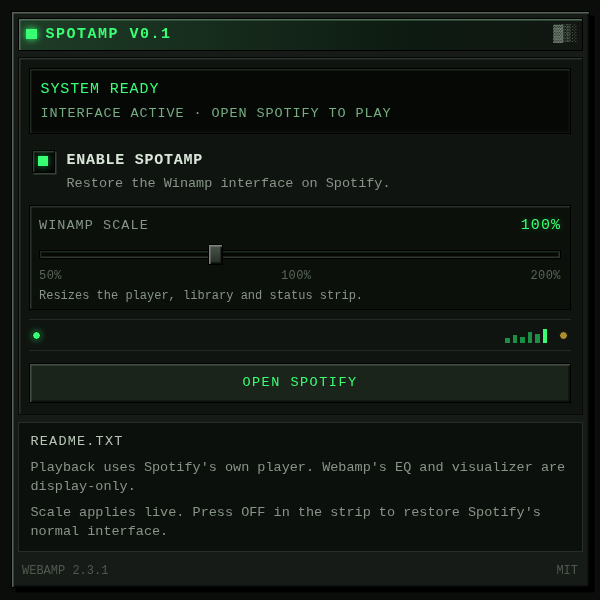

# Spotamp quick start

Get the Winamp interface running against your real Spotify Web Player in about
a minute. No Spotify developer account, API key, or server is required.

## Requirements

- Node.js **20 or newer** (Node 22/24 also works) and npm.
- Chrome, Edge, Brave, or another Chromium browser **114 or newer**, or
  Firefox **113 or newer**.
- A normal Spotify account signed in at <https://open.spotify.com/>.

## 1. Build it

From the project root:

```bash
npm ci
npm run build
```

`npm run build` creates a clean, production-ready `dist/` directory. That
folder is the extension; the source code stays in `src/` and `public/`.

For Firefox, build the Manifest V2 variant instead:

```bash
npm run build:firefox
```

That writes the extension to `dist-firefox/`. Firefox 113 cannot grant
Manifest V3 host permissions at install time, so the MV3 `dist/` build will not
inject its content script there; the MV2 build runs without extra permission
clicks.

## 2. Load the extension

### Chrome / Edge / Brave

1. Open `chrome://extensions` (or `edge://extensions`).
2. Turn on **Developer mode**.
3. Click **Load unpacked**.
4. Select the `dist/` folder.

Spotamp appears in the toolbar. Pin it if you want quick access to the
settings popup.

### Firefox

1. Open `about:debugging#/runtime/this-firefox`.
2. Click **Load Temporary Add-on…**.
3. Select `dist-firefox/manifest.json`.

Temporary add-ons disappear when Firefox closes; load the folder again after a
restart, or sign the package for a permanent install. Spotamp appears in the
toolbar.

## 3. Open Spotify

Go to <https://open.spotify.com/> and sign in if needed. Spotamp is enabled by
default. The Spotify top bar, sidebar, content pane, and bottom bar are replaced
by:

- The **Winamp main window** — transport, seek, volume, time.
- The **playlist editor** — tracks from the current Spotify page.
- The **equalizer** — display-only because Spotify's audio is never captured.
- The **Winamp library** — `home\`, `search\`, `liked-songs\`, `playlists\`,
  saved playlists, and links from the current page.
- The **status strip** — shuffle mode, connection state, scale, library, player,
  help, and the kill switch.

If the interface does not appear, refresh the Spotify tab once. The browser
only injects the content script into pages loaded after the extension was
installed or updated.

## 4. Use it

- Click a folder in the library to navigate Spotify without a page reload.
- Click a row in the Webamp playlist to ask Spotify to play that track.
- Use the status strip's `SHUF` button to cycle **OFF → ON → SMART**.
- Press `2X` (or Winamp's `Ctrl+D`) to switch between 100% and 200%.
- Open the toolbar popup to enable/disable Spotamp or choose any **50–200%**
  scale in 5% steps. Scale changes apply live.



## 5. Turn it off

Click **OFF** in the status strip, or turn off **ENABLE SPOTAMP** in the popup.
Spotify's normal interface returns immediately; refresh only if Spotify itself
is in a bad state. To remove it completely, use **Remove** on the extension's
card in `chrome://extensions`, or remove the temporary add-on in
`about:debugging#/runtime/this-firefox`.

## Development

```bash
npm run dev           # rebuild the Chromium content script on change
npm run dev:firefox   # rebuild dist-firefox/content.js on change
npm run typecheck     # TypeScript
npm run lint          # ESLint
npm test              # Vitest + jsdom, 65 tests
npm run build         # production build in dist/
npm run build:firefox # production MV2 build in dist-firefox/
```

While developing, reload the extension in `chrome://extensions` (or
`about:debugging#/runtime/this-firefox`) and refresh the Spotify tab after each
content-script change. The Spotify tab still needs a refresh.

## Shipping a release

```bash
npm run package          # Chrome/Edge, MV3
npm run package:firefox  # Firefox, MV2
```

Each runs the matching production build and writes
`release/spotamp-<version>.zip` or `release/spotamp-firefox-<version>.zip` with
`manifest.json` at the archive root. Bump the version in both `package.json`
and `public/manifest.json` first; the build refuses to run if they disagree.
See [README.md](README.md#shipping-a-release) for the full checklist.

## Troubleshooting

| Problem | Fix |
| --- | --- |
| Spotify looks normal | Reload the extension in `chrome://extensions` (or `about:debugging#/runtime/this-firefox` on Firefox), then refresh the Spotify tab. Make sure Spotamp is enabled in the popup. |
| No player or transport controls | Spotify's player bar must exist. Open a track, press play in Spotify itself once, then use the Webamp controls. |
| Playlist is empty | Spotify has not finished loading the page. Wait for the page, then click a folder in the library. |
| Library or windows are off-screen | Set the scale to 100% in the popup, then use `2X` again. Drag windows back by their title bars. |
| Play/pause or shuffle does nothing | Spotify rejected the action (signed out, no active device, or the control is disabled). The status strip shows the reason. |
| A Spotify redesign broke styling | Spotamp uses accessible selectors in `src/content/selectors.ts`; update them from the live DOM. Styling degrades gracefully instead of stopping playback. |
| `Version mismatch` during build | Set the same version in `package.json` and `public/manifest.json`. |

## Privacy in one line

Settings are stored with `chrome.storage.sync`; Spotamp does not collect,
transmit, or sell data, does not use analytics, and never downloads or captures
Spotify audio. See [README.md](README.md#privacy-and-permissions).
